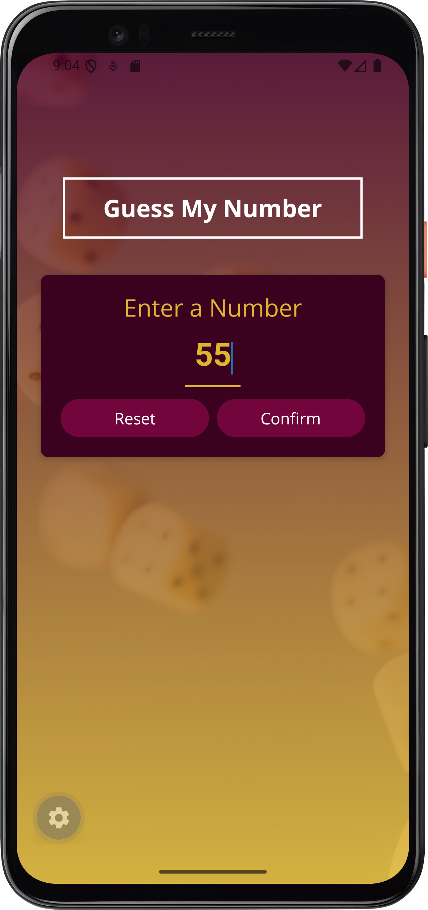
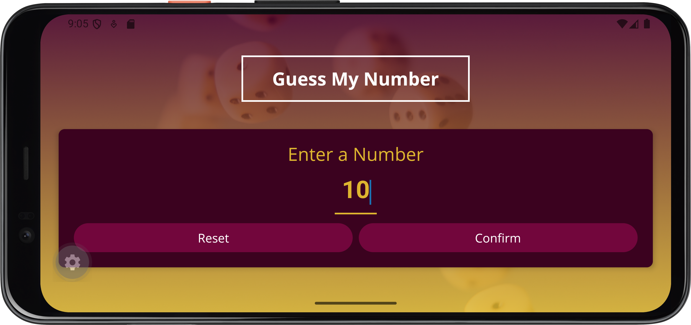
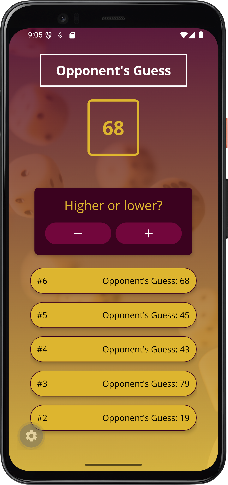
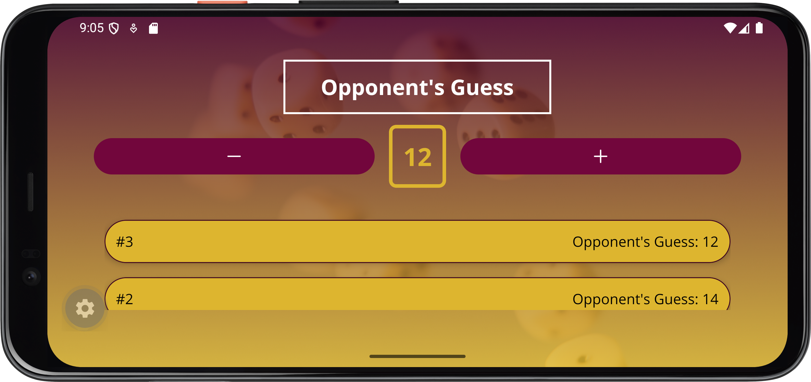
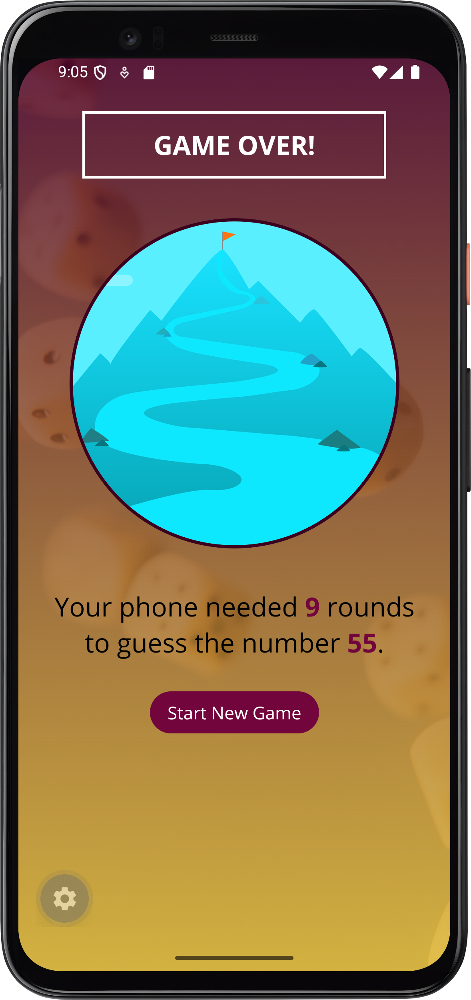
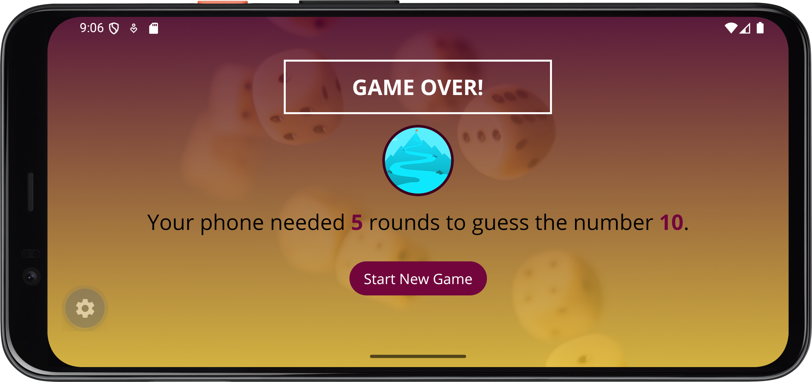

# Guess My Number 🎮 — Mini Game App

An interactive, responsive mobile number guessing game built with **React Native**, **Expo (SDK 57)**, and **React 19**. 

In this game, the player picks a secret number between 1 and 99, and the phone attempts to guess it. The player guides the phone with **Higher** or **Lower** buttons while the computer calculates guesses, logs each round, and prevents dishonest clues with built-in cheat detection!

---

## ✨ Features

- 🎯 **Interactive Guessing Gameplay**:
  - Pick a number between 1 and 99 with full validation.
  - Guide the computer with Higher (`+`) and Lower (`-`) buttons.
  - Built-in cheat detection warns players if they give false hints!
- 🔄 **Full Responsiveness (Portrait & Landscape)**:
  - Dynamically adapts between portrait and landscape modes using React Native's `useWindowDimensions` hook.
  - **Portrait Mode**: Elegant vertical card-based hierarchy with custom typography and generous spacing.
  - **Landscape Mode**: Specialized horizontal layout in the game screen (placing `-` and `+` buttons alongside the guess number), dynamic top margins, and scaled circular images to prevent vertical scrolling and element overflow.
- 📜 **Real-Time Guess Logs**:
  - A scrollable `FlatList` tracking every guess round and the computer's previous choices.
- 🎨 **Custom Design & Polished UI**:
  - Custom Google Fonts (`OpenSans-Regular`, `OpenSans-Bold`).
  - Vector icons via `react-native-vector-icons/Ionicons`.
  - Gradient background using `expo-linear-gradient` layered over background imagery.
  - Reusable custom UI components (`Card`, `Title`, `PrimaryButton`, `InstructionText`, `NumberContainer`).
  - Safe area handling via `react-native-safe-area-context` and adaptive status bar.

---

## 📸 Screenshots Showcase

### 1. Start Game Screen
Input validation, custom number pad, and dynamic margin adaptation.

| Portrait Mode | Landscape Mode |
| :---: | :---: |
|  |  |

---

### 2. Game Screen
Opponent guessing screen featuring real-time round history. In landscape mode, the buttons automatically shift into a horizontal row alongside the number container.

| Portrait Mode | Landscape Mode |
| :---: | :---: |
|  |  |

---

### 3. Game Over Screen
Shows total rounds needed to guess the number. The circular victory illustration dynamically scales down in landscape to keep the summary and action button in full view.

| Portrait Mode | Landscape Mode |
| :---: | :---: |
|  |  |

---

## 📐 Responsive Design Architecture

The app uses React Native's `useWindowDimensions` hook to dynamically query device dimensions on orientation change:

```javascript
const { width, height } = useWindowDimensions();
```

### Key Responsive Adaptations:
1. **[app.json](app.json)**:
   - Configured `"orientation": "default"` to enable automatic orientation switching on Android and iOS.
2. **Start Screen (`screens/StartGameScreen.js`)**:
   - `marginTop` adapts to device height (`height < 380 ? 30 : 100`) to avoid unnecessary vertical spacing in landscape.
3. **Game Screen (`screens/GameScreen.js`)**:
   - When `width > 500` (landscape), switches from vertical card stacking to a horizontal layout (`buttonsContainerWide`), positioning the `-` button, `<NumberContainer>`, and `+` button side-by-side.
4. **Game Over Screen (`screens/GameOverScreen.js`)**:
   - Image dimensions adapt dynamically (`imageSize = height < 400 ? 80 : (width < 380 ? 150 : 300)`) with scaled margins so all content stays visible without scrolling.
5. **Number Container (`components/game/NumberContainer.js`)**:
   - Compact padding, margins, and font size when `height < 400 || width < 380` to fit snugly between horizontal controls.

---

## 📁 Project Structure

```text
mini-game-app/
├── assets/
│   ├── fonts/               # Custom OpenSans TTF fonts
│   ├── images/              # Backgrounds, splash, and app icons
│   └── screenshots/         # Portrait & landscape screenshots
├── components/
│   ├── game/
│   │   ├── GuessLogItem.js      # Individual log row for FlatList
│   │   └── NumberContainer.js   # Highlighted guess number badge
│   └── ui/
│       ├── Card.js              # Frosted elevation card container
│       ├── InstructionText.js   # Styled instruction label
│       ├── PrimaryButton.js     # Custom pressable button with ripple
│       └── Title.js             # Outlined screen title
├── screens/
│   ├── StartGameScreen.js   # Number selection & validation screen
│   ├── GameScreen.js        # Active gameplay screen with responsive layout
│   └── GameOverScreen.js    # Victory recap & restart screen
├── utils/
│   ├── Colors.js            # App theme color palette
│   └── game.js              # Random number generator with exclusion
├── App.js                   # Root component, font loading & state management
├── app.json                 # Expo configuration (unlocked orientation)
└── package.json             # Dependencies and scripts
```

---

## 🛠️ Tech Stack & Dependencies

- **Framework**: [React Native](https://reactnative.dev/) `0.86.3`
- **Platform**: [Expo](https://expo.dev/) `~57.0.29`
- **Core Libraries**:
  - `expo-font`: Custom typography loading
  - `expo-splash-screen`: Splash screen display & async dismiss
  - `expo-linear-gradient`: Rich background gradients
  - `react-native-safe-area-context`: Notches and system safe area padding
  - `react-native-vector-icons`: Ionicons for controls

---

## 🚀 Getting Started

### Prerequisites
- Node.js (v18 or newer recommended)
- [Expo Go](https://expo.dev/go) app on your physical mobile device, or an iOS Simulator / Android Emulator.

### Installation

1. **Clone the repository**:
   ```bash
   git clone <repository-url>
   cd mini-game-app
   ```

2. **Install dependencies**:
   ```bash
   npm install
   ```

3. **Start the development server**:
   ```bash
   npx expo start
   ```

4. **Run on your platform of choice**:
   - Press <kbd>a</kbd> for Android emulator / device
   - Press <kbd>i</kbd> for iOS simulator
   - Press <kbd>w</kbd> for Web browser
   - Scan the QR code with **Expo Go** (Android) or the **Camera app** (iOS)

---

## 🧪 Code Quality & Scripts

- **Linting**:
  ```bash
  npm run lint
  ```
- **Type Checking**:
  ```bash
  npx tsc --noEmit
  ```

---

## 📄 License
This project is open source and available under the [MIT License](LICENSE).
